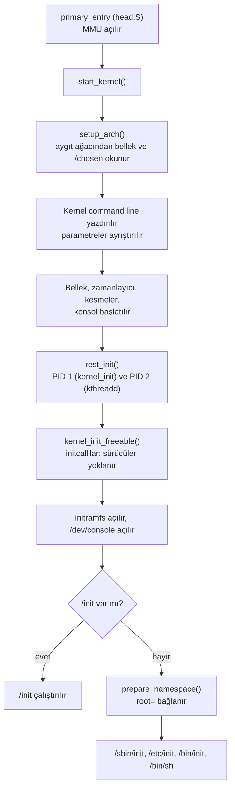

# 1 · Önyükleme zinciri: ROM'dan init'e

<div class="kunye" markdown>
<span>Süre: ~50 dk + uygulama</span><span>Düzey: Orta</span><span>Ön koşul: Linux komut satırı, temel C derleme bilgisi</span>
</div>

!!! hedef "Öğrenme hedefleri"
    Bu bölümün sonunda:

    - Bir ARM tabanlı gömülü sistemin güç verildiği andan ilk kullanıcı alanı sürecine kadar geçtiği aşamaları sırasıyla açıklayabilirsiniz.
    - Boot ROM, SPL/TPL, TF-A, OP-TEE ve U-Boot'un görev ve sınırlarını ayırt edebilirsiniz.
    - Çekirdek, aygıt ağacı ve initramfs için yükleme adreslerini çakışmayacak biçimde seçebilirsiniz.
    - Çekirdeğin açılış sırasını, initramfs'in rolünü ve kök dosya sisteminin bağlanmasını açıklayabilirsiniz.
    - PID 1'in nasıl seçildiğini ve neden özel bir süreç olduğunu açıklayabilirsiniz.
    - Gömülü ARM önyüklemesini x86 UEFI/GRUB önyüklemesiyle karşılaştırabilirsiniz.

## 1.1 Önyükleme neden bir zincirdir?

Bir işlemciye güç verildiğinde ana bellek (DRAM) henüz başlatılmamıştır; bellek denetleyicisinin karta
özgü zamanlama değerleri bilinmeden DRAM'e tek bir bayt bile yazılamaz. Saatler düşük hızlı varsayılan
kaynaktadır, depolama denetleyicileri yapılandırılmamıştır. İşlemcinin bu anda güvenebileceği yegâne
şeyler, yongaya üretimde yazılmış salt okunur kod (Boot ROM) ve birkaç yüz kilobaytlık yonga içi statik
bellektir (SRAM).

Çekirdek ise megabaytlarca yer kaplar ve yüzlerce megabayt DRAM'e, doğru saatlere ve bir donanım
tanımına ihtiyaç duyar. Aradaki boşluk tek adımda kapatılamaz. Önyükleme bu nedenle bir **zincir**
olarak tasarlanır: her aşama bir sonrakinin çalışabileceği ortamı hazırlar, onu belleğe yükler ve
denetimi ona devreder.

İkinci gerekçe **güvendir**: güvenli önyüklemede (*secure boot*) her aşama bir sonrakinin imzasını
denetler. Zincirin kökü değiştirilemeyen Boot ROM ve eFuse/OTP sigortalarındaki açık anahtar özetidir;
bir halka denetimi atlarsa sonrakilerin güvenilirliği kalmaz.

Örnek ürün ekransız bir **endüstriyel sensör ağ geçididir** (`agecidi`). Uygulamalar QEMU'nun ARM64
`virt` makinesinde yapılır; gerçek karta özgü aşamalar (Boot ROM, SPL, TF-A) kavramsal olarak anlatılır.
Aşağıdaki animasyon imajların depolamadan SRAM'e, oradan DRAM'e taşınmasını gösterir:

<div class="akis" data-senaryo="onyukleme-zinciri"></div>

## 1.2 Boot ROM

**Boot ROM** (*mask ROM*), yonga üreticisinin işlemciye gömdüğü ve değiştirilemeyen ilk koddur.
Görevleri yongadan yongaya değişse de genel olarak şunlardır:

1. **Kaynak seçimi:** önyükleme pinleri (*boot mode pins*) veya eFuse değerleri okunarak kodun hangi
   birimden (eMMC, SD, SPI NOR, NAND, USB, UART) alınacağı belirlenir; başarısızlıkta çoğu yonga USB veya
   UART üzerinden kurtarma kipine geçer.
2. **SRAM'e yükleme:** yongaya özgü başlıkla paketlenmiş, SRAM'e sığan (64 KiB – birkaç yüz KiB) küçük
   bir program okunur.
3. **İmza doğrulaması:** güvenli önyükleme etkinse imza eFuse'taki anahtar özetiyle doğrulanır (ör. NXP
   i.MX'te HAB/AHAB).
4. **Devir:** doğrulanan program SRAM'de çalıştırılır.

Boot ROM'un davranışı yonganın başvuru kılavuzunda (*reference manual*) belgelenir. Bazı yongalar ilk
imajı diskin belirli bir sektöründe, bazıları FAT bölümündeki belirli adlı bir dosyada (TI AM335x'te
`MLO`) arar; disk düzeni bu nedenle yongaya özgüdür ve Yocto'da `WKS_FILE` ile tanımlanır.

!!! dikkat "Boot ROM'un hatası düzeltilemez"
    ROM kodu değiştirilemediği için içindeki hatalar ancak yonga revizyonuyla giderilebilir. Üreticiler
    bu tür sorunları *errata* belgelerinde yayımlar. Özellikle güvenli önyükleme tasarlanırken yonganın
    errata listesi incelenmelidir.

## 1.3 SPL ve TPL: DRAM'i başlatan aşama

Boot ROM'un yüklediği program, U-Boot projesinde **SPL** (*Secondary Program Loader*) adını taşır. SPL,
U-Boot ile aynı kaynak ağacından, ancak çok daha az özellikle derlenen küçük bir önyükleyicidir. En
önemli görevi **DRAM'i başlatmaktır**: bellek denetleyicisine karta özgü zamanlama değerleri yazılır,
gerekiyorsa eğitim (*DDR training*) algoritmaları çalıştırılır. DRAM kullanılabilir hale geldikten sonra
SPL, bir sonraki aşamayı depolama biriminden DRAM'e yükler.

SRAM'in SPL için bile yetersiz kaldığı yongalarda zincire bir halka daha eklenir: **TPL**
(*Tertiary Program Loader*). Bu durumda sıra ROM → TPL → SPL → U-Boot olur; TPL yalnızca DRAM'i başlatır
ve SPL'yi yükler. Her iki aşama da U-Boot derlemesinin yan ürünleridir: derleme dizininde `spl/u-boot-spl.bin`
ve `tpl/u-boot-tpl.bin` dosyaları oluşur. Üreticinin araçları bu dosyaları Boot ROM'un beklediği
başlıkla paketler (ör. `u-boot-with-spl.bin`, `flash.bin`, `idbloader.img` gibi yongaya özgü adlar).

!!! sss "DRAM başlatma kodu her zaman açık kaynak mıdır?"
    Hayır. Bazı yongalarda DRAM eğitim kodu üreticinin kapalı bir ikili dosyasıdır. Yocto BSP
    katmanlarında bu dosyalar genellikle ayrı bir tarif ve `LICENSE_FLAGS` ile gelir.

## 1.4 TF-A ve OP-TEE: güvenli dünya

ARMv8-A mimarisinde işlemci dört **ayrıcalık düzeyinde** (*Exception Level*) çalışabilir: EL0
(kullanıcı uygulamaları), EL1 (işletim sistemi çekirdeği), EL2 (hipervizör) ve EL3 (güvenli izleyici,
*secure monitor*). Ayrıca TrustZone ile işlemci "güvenli" ve "güvenli olmayan" iki dünyaya ayrılır.
Linux, güvenli olmayan dünyada EL1'de (sanallaştırma kullanılıyorsa EL2'de) çalışır.

**TF-A** (*Trusted Firmware-A*, eski adıyla ARM Trusted Firmware, ATF) EL3'te çalışan başvuru ürün
yazılımıdır. TF-A belgeleri önyükleme aşamalarını şöyle adlandırır:

| Aşama | TF-A adı | Tipik karşılığı |
|---|---|---|
| BL1 | AP Trusted ROM | Yonganın Boot ROM'u |
| BL2 | Trusted Boot Firmware | TF-A BL2 veya U-Boot SPL |
| BL31 | EL3 Runtime Software | TF-A BL31 (sürekli bellekte kalır) |
| BL32 | Secure-EL1 Payload | OP-TEE (isteğe bağlı) |
| BL33 | Non-trusted Firmware | U-Boot (EL2 veya EL1'de) |

BL31 önyüklemeden sonra da bellekte kalır. Linux, işlemci çekirdeklerini açıp kapatmak ve sistemi
yeniden başlatmak için **PSCI** (*Power State Coordination Interface*) çağrılarını `smc` ile BL31'e
iletir; aygıt ağacındaki `psci` düğümü ve `enable-method = "psci"` bunun içindir
([Bölüm 4](04-aygit-agaci.md)). QEMU `virt` makinesinde PSCI'yi QEMU sağlar (`method = "hvc"`).

**OP-TEE** (*Open Portable Trusted Execution Environment*), güvenli dünyada çalışan küçük bir işletim
sistemidir; anahtar saklama ve kriptografik işlemler, Linux ele geçirilse bile erişilemeyecek güvenilir
uygulamalarda yapılır. Linux bu hizmetlere `tee` alt sistemiyle erişir.

Pek çok ARM64 yongada (Rockchip, Allwinner, NXP i.MX8M) U-Boot SPL, TF-A'nın BL2 rolünü üstlenir:
BL31'i, varsa OP-TEE'yi ve U-Boot'u DRAM'e yükleyip denetimi BL31'e verir; BL31 de U-Boot'u başlatır.

!!! iyi "Her aşamanın sürümü bilinmelidir"
    TF-A, OP-TEE veya U-Boot için bir güvenlik açığı duyurulduğunda ürünün hangi sürümü kullandığı hızla
    bulunabilmelidir. Yocto'da bunlar ayrı tariflerdir ve SBOM'da ayrı görünür
    (<a href="../../yocto-gomulu-linux/bolumler/16-lisans-sbom.html">Yocto kitabı, Bölüm 16</a>).

## 1.5 U-Boot ve yükleme adresleri

**U-Boot** (*U-Boot proper*) zincirin kullanıcıyla etkileşebilen ilk halkasıdır. DRAM'de çalışır;
dosya sistemlerini okuyabilir, ağdan dosya indirebilir, komut satırı ve betik desteği sunar. Görevi,
çekirdeği, aygıt ağacını ve isteğe bağlı initramfs'i belleğe yükleyip çekirdeği uygun koşullarla
başlatmaktır. Ayrıntılar [Bölüm 2](02-u-boot.md)'dedir; burada yalnızca **yükleme adresleri** ele alınır.

Üç dosya DRAM'de birbirinin üzerine yazılmayacak biçimde yerleştirilmelidir. U-Boot bu adresleri
ortam değişkenlerinde tutar. QEMU `virt` makinesindeki U-Boot 2025.10'un varsayılan değerleri
(DRAM `0x40000000` adresinden başlar):

| Değişken | Değer | İçerik |
|---|---|---|
| `fdt_addr` | `0x40000000` | QEMU'nun ürettiği aygıt ağacı (DRAM'in başı) |
| `scriptaddr` | `0x40200000` | `boot.scr` betiği |
| `pxefile_addr_r` | `0x40300000` | `extlinux.conf` / PXE yapılandırması |
| `kernel_addr_r` | `0x40400000` | Çekirdek (`Image`) |
| `ramdisk_addr_r` | `0x44000000` | initramfs |

Bu düzende çekirdeğe `0x44000000 − 0x40400000 = 0x3C00000`, yani 60 MiB yer ayrılmıştır. Çekirdek
belleğe kopyalandıktan sonra kendi `.bss` alanı ve erken sayfa tabloları için ek yer kullanır; bu nedenle
dosya boyutu değil, ARM64 `Image` başlığındaki `image_size` alanı esas alınmalıdır. Çekirdek belgesi
`Documentation/arch/arm64/booting.rst` ARM64 için şu kuralları koyar:

- Çekirdek `Image` dosyası 2 MiB hizalı bir taban adresinden itibaren yerleştirilir.
- Aygıt ağacı 8 bayt hizalı olmalı ve 2 MiB'ı aşmamalıdır.
- Önyükleyici yalnızca `x0` yazmacına aygıt ağacının fiziksel adresini koyar; `x1`–`x3` sıfır olmalıdır.
  Çekirdeğe atlanırken MMU kapalı olmalıdır.
- ARM64 çekirdeğinin kendi açıcısı (*decompressor*) yoktur: `Image.gz` kullanılıyorsa açma işini
  önyükleyici yapar. 32 bit ARM'deki `zImage` ise kendini açan bir koddur.

!!! dikkat "Sessiz çakışma: initramfs çekirdeğin üzerine yazıldığında"
    Yükleme adresleri yanlış seçildiğinde U-Boot genellikle hata vermez; dosyalar sırayla yüklenir ve
    sonraki dosya öncekinin bir bölümünü ezer. Belirti, çekirdeğin hiç ileti vermeden donması veya
    `Starting kernel ...` satırından sonra rastgele bir istisnadır. Çekirdek büyütüldüğünde (ör. hata
    ayıklama sembolleri eklendiğinde) daha önce çalışan bir düzen bozulabilir. Yükleme sonrasında
    `${filesize}` değeri ile her dosyanın bitiş adresi denetlenmelidir.

## 1.6 Çekirdeğin açılışı

`booti` komutu çekirdeğe atladığında ilk çalışan kod `arch/arm64/kernel/head.S` içindeki
`primary_entry` yordamıdır. Bu kod önyükleyicinin bıraktığı durumu kaydeder, erken sayfa tablolarını
kurar, MMU'yu açar ve C dilindeki `start_kernel()` işlevine (`init/main.c`) atlar. Açılışın kaba sırası:



`setup_arch()` aşamasında aygıt ağacından bellek ve `/chosen/bootargs` okunur; ağacın tamamı sonra
sürücülerin yoklanmasında kullanılır ([Bölüm 4](04-aygit-agaci.md)).

`rest_init()` iki çekirdek iş parçacığı oluşturur: **PID 1** olacak `kernel_init` ve diğer çekirdek iş
parçacıklarının ebeveyni olan **PID 2** `kthreadd`. `kernel_init`, sürücülerin ve alt sistemlerin
başlatma işlevlerini (*initcall*) belirli düzeyler sırasıyla çağırır. Konsolda görülen iletilerin büyük
bölümü bu aşamada üretilir. İletiler `printk` halka arabelleğinde de tutulduğundan açılıştan sonra
`dmesg` ile okunabilir ([Bölüm 8](08-cekirdek-hata-ayiklama.md)).

Çekirdeğin tanımadığı komut satırı parametreleri `Unknown kernel command line parameters "...", will
be passed to user space.` iletisiyle bildirilir ve init sürecine iletilir; örnek initramfs `kurtarma`
parametresini bu yolla tanır.

## 1.7 initramfs: erken kullanıcı alanı

**initramfs**, çekirdeğin açılış sırasında belleğe açtığı küçük bir kök dosya sistemidir. Biçimi `newc`
türünde bir **cpio** arşividir ve genellikle gzip, xz, lz4 veya zstd ile sıkıştırılır. Çekirdek arşivi,
her zaman var olan ilk kök dosya sistemine (*rootfs*, bir tmpfs veya ramfs örneği) açar ve içinde `/init`
varsa onu PID 1 olarak çalıştırır (çalıştırılacak dosya `rdinit=` parametresiyle değiştirilebilir).

initramfs'in varlık nedeni, kök dosya sistemini bağlamak için çekirdeğin tek başına yapamayacağı işlerin
bulunmasıdır:

- Depolama sürücüsünün modül olarak derlenmiş olması (dağıtım çekirdekleri)
- Şifreli (dm-crypt), mantıksal (LVM) veya ağ üzerindeki (iSCSI, NFS) kök dosya sistemleri
- A/B güncelleme düzeninde hangi bölümün etkin olduğuna karar verilmesi
- Kök dosya sistemi bağlanmadan önce `fsck` veya fabrika ayarlarına dönüş işlemleri

initramfs, önyükleyicinin ayrıca yüklediği bir dosya (`booti`'nin ikinci argümanı) olarak verilebilir ya
da `CONFIG_INITRAMFS_SOURCE` ile çekirdeğe gömülebilir; ikincisi her değişiklikte çekirdeğin yeniden
derlenmesini gerektirir. Yocto'da `INITRAMFS_IMAGE` değişkeni initramfs
imaj tarifini, `INITRAMFS_IMAGE_BUNDLE = "1"` ise bu imajın çekirdeğe gömülmesini seçer
(<a href="../../yocto-gomulu-linux/bolumler/09-imajlar.html">Yocto kitabı, Bölüm 9</a>).

!!! info ":material-history: Önceki yöntem: initrd"
    initramfs'ten önce kullanılan **initrd**, bir blok aygıtı (`/dev/ram0`) olarak bağlanan dosya sistemi
    imajıydı ve çekirdekte ilgili dosya sistemi sürücüsünü gerektiriyordu. initramfs ise dosya sistemi
    sürücüsü gerektirmeyen bir arşivdir ve doğrudan sayfa önbelleğinde yaşar. Önyükleyici komutlarında
    ve çekirdek seçeneklerinde (`CONFIG_BLK_DEV_INITRD`, `initrd=`) eski ad korunmuştur.

Örnek initramfs, BusyBox ve kitabın `examples/initramfs/init` betiğinden oluşur. Betik sanal dosya
sistemlerini bağlar, `root=` parametresini okur, kök aygıtı belirene kadar bekler ve **switch_root** ile
kalıcı kök dosya sistemine geçer:

```sh title="examples/initramfs/init (kısaltılmış)"
mount -t proc     proc     /proc
mount -t sysfs    sysfs    /sys
mount -t devtmpfs devtmpfs /dev          # (1)!

for p in $(cat /proc/cmdline); do         # (2)!
    case "$p" in
        root=*)   kok="${p#root=}" ;;
        kurtarma) exec /bin/sh ;;
    esac
done

mount -t ext4 -o ro "$kok" /yenikok
mount --move /dev  /yenikok/dev           # (3)!
mount --move /proc /yenikok/proc
mount --move /sys  /yenikok/sys
exec switch_root /yenikok /sbin/init     # (4)!
```

1.  `CONFIG_DEVTMPFS_MOUNT` initramfs ile açılışta uygulanmaz (Kconfig açıklaması); `/dev` elle bağlanır.
2.  `/init` bulunduğunda çekirdek `root=` değerini kendisi kullanmaz; bu iş initramfs'e kalır.
3.  Sanal dosya sistemleri yeni köke **taşınır**.
4.  `switch_root` initramfs'i siler, yeni köke geçer ve programı `exec` eder; yeni init de PID 1'dir.

Aşağıdaki animasyon bu geçişi adım adım gösterir:

<div class="akis" data-senaryo="initramfs-gecis"></div>

Arşivin içeriği derleme makinesinde `cpio` ile incelenebilir. Aşağıdaki oturum bu ortamda
`examples/qemu/kok-olustur.sh` ile üretilen arşiv üzerinde çalıştırılmıştır:

<div class="terminal" data-oturum="initramfs-icerik"></div>

## 1.8 Kök dosya sisteminin bağlanması

initramfs kullanılmadığında (veya içinde `/init` bulunmadığında) kök dosya sistemini çekirdek bağlar.
`prepare_namespace()` işlevi şu parametreleri kullanır:

| Parametre | Anlamı | Örnek |
|---|---|---|
| `root=` | Kök aygıtı | `/dev/vda2`, `/dev/mmcblk0p2`, `PARTUUID=…`, `/dev/nfs` |
| `rootfstype=` | Dosya sistemi türü; verilmezse kayıtlı türler sırayla denenir | `ext4` |
| `rootwait` | Aygıt belirene kadar süresiz bekle | USB ve SD kartlarda gereklidir |
| `ro` / `rw` | Salt okunur veya yazılabilir bağlama | Genellikle `ro`; init daha sonra `rw` yapar |
| `init=` | Kök bağlandıktan sonra çalıştırılacak program | `/bin/sh` (kurtarma için) |

`/dev/mmcblk0p2` gibi adlar sürücülerin yoklanma sırasına bağlıdır ve çekirdek sürümüyle değişebilir;
bölüm tablosundaki kimliğe dayanan `root=PARTUUID=<kimlik>` daha sağlamdır.
Kök aygıtı bulunamazsa çekirdek `VFS: Unable to mount root fs on ...` iletisiyle durur
(*kernel panic*). Bu iletinin hemen öncesinde çekirdek bildiği blok aygıtlarını listeler; aranan
aygıtın listede olmaması, sürücünün çekirdekte bulunmadığını veya modül olarak derlendiğini gösterir.

## 1.9 init ve PID 1

Kök dosya sistemi hazır olduğunda çekirdek ilk kullanıcı alanı programını çalıştırır. `init/main.c`
içindeki `kernel_init()` sırası şöyledir: önce `rdinit=` (varsayılan `/init`), sonra `init=` ile verilen
program, sonra derleme sırasında `CONFIG_DEFAULT_INIT` ile belirlenen program ve en son sırasıyla
`/sbin/init`, `/etc/init`, `/bin/init` ve `/bin/sh` denenir. Hiçbiri çalıştırılamazsa çekirdek
`No working init found.` iletisiyle durur.

PID 1 sıradan bir süreç değildir:

- **Sonlanmamalıdır.** PID 1 sonlanırsa çekirdek `Attempted to kill init!` iletisiyle panik durumuna geçer.
- **Öksüz süreçleri devralır.** Ebeveyni sonlanan her süreç PID 1'e bağlanır; PID 1 bu süreçlerin çıkış
  durumunu `wait()` ile toplamazsa sistemde zombi süreçler birikir.
- **Sinyal davranışı farklıdır.** Çekirdek, PID 1'e işleyici tanımlamadığı sinyalleri iletmez. Bu
  nedenle `kill -TERM 1` varsayılan olarak hiçbir etki yapmaz.
- **Sistemi yönetir:** servisler, oturum açma istemi ve kapanış ([Bölüm 6](06-init-systemd.md)).

!!! lab "Uygulama 1.1 · QEMU'da önyükleme zincirinin izlenmesi"
    Bu uygulamada Linux 6.18 çekirdeği ARM64 için derlenir, BusyBox tabanlı bir kök dosya sistemi ve
    initramfs hazırlanır ve sistem QEMU'da U-Boot üzerinden açılır. Ubuntu 24.04 tabanlı bir geliştirme
    makinesinde gereken paketler:

    ```bash
    sudo apt install qemu-system-arm u-boot-qemu gcc-aarch64-linux-gnu u-boot-tools \
         device-tree-compiler flex bison bc libssl-dev libelf-dev cpio fdisk busybox-static
    ```

    Kitap deposu ve çekirdek kaynağı indirilir, çekirdek ve örnek modül derlenir (ayrıntılar
    [Bölüm 3](03-cekirdek-derleme.md)):

    ```bash
    git clone https://github.com/mfguney/cekirdek-onyukleme.git ~/cekirdek-onyukleme
    git clone --depth 1 -b v6.18 \
        https://git.kernel.org/pub/scm/linux/kernel/git/torvalds/linux.git ~/linux
    cd ~/cekirdek-onyukleme/examples
    sh cekirdek/derle.sh ~/linux ~/agecidi/cekirdek
    make -C modul KDIR=~/agecidi/cekirdek ARCH=arm64 CROSS_COMPILE=aarch64-linux-gnu-
    ```

    Kök dosya sistemi BusyBox'ın ARM64 statik derlemesiyle hazırlanır. Bu kitaptaki çıktılar Ubuntu
    ports deposundaki `busybox-static` 1.36.1 paketinin `arm64` sürümüyle alınmıştır:

    ```bash
    mkdir -p ~/agecidi/bb && cd ~/agecidi/bb
    curl -O http://ports.ubuntu.com/ubuntu-ports/pool/main/b/busybox/busybox-static_1.36.1-6ubuntu3_arm64.deb
    dpkg-deb -x busybox-static_1.36.1-6ubuntu3_arm64.deb .
    cd ~/cekirdek-onyukleme/examples
    sh qemu/kok-olustur.sh ~/agecidi/bb/usr/bin/busybox ~/agecidi/cekirdek modul ~/agecidi
    cp ~/agecidi/cekirdek/arch/arm64/boot/Image ~/agecidi/
    sh qemu/disk-olustur.sh ~/agecidi
    sh qemu/calistir.sh uboot ~/agecidi
    ```

    `root` kullanıcısıyla parolasız oturum açılır; QEMU'dan ++ctrl+a++ ardından ++x++ ile çıkılır.
    Aşağıdaki oturum bu ortamda alınan konsol çıktısının kısaltılmış halidir:

    <div class="terminal" data-oturum="qemu-acilis"></div>

    Çıktıda şu noktalar bulunmalıdır:

    1. U-Boot'un DRAM boyutunu (`DRAM:  512 MiB`) ve ağ aygıtını bulduğu satırlar
    2. `extlinux.conf` dosyasının okunduğu ve çekirdeğin yüklendiği satırlar
    3. `Booting Linux on physical CPU 0x0000000000` ile başlayan çekirdek iletileri, `Machine model:` ve
       `Kernel command line:` satırları
    4. initrd verilmediği için `check access for rdinit=/init failed: -2, ignoring` uyarısı, ardından
       `VFS: Mounted root (ext4 filesystem) readonly on device 254:2.` ve `Run /sbin/init as init process`
       satırları

## 1.10 x86 sistemlerle karşılaştırma: UEFI ve GRUB

x86 tabanlı endüstriyel bilgisayarlarda zincirin halkaları farklıdır. Anakart üzerindeki ürün yazılımı
(bir UEFI uygulaması, çoğunlukla bir BIOS üreticisinin ürünü) SPI flaş bellekte durur ve DRAM başlatma
dahil tüm donanım hazırlığını kendisi yapar. Donanım tanımı aygıt ağacı yerine **ACPI** tablolarıyla
verilir; PCI ve USB gibi veri yolları çalışma anında taranabilir.

| | Gömülü ARM64 | x86-64 (UEFI) |
|---|---|---|
| İlk kod | Boot ROM (yonga içinde) | SPI flaştaki UEFI ürün yazılımı |
| DRAM başlatma | SPL/TPL veya TF-A BL2 | UEFI ürün yazılımı (PEI aşaması) |
| Güvenli dünya / izleyici | TF-A BL31, OP-TEE | SMM (System Management Mode) |
| Önyükleyici | U-Boot | GRUB, systemd-boot veya doğrudan EFI stub |
| Önyükleyicinin yeri | Yongaya özgü ofset veya bölüm | EFI Sistem Bölümü (ESP, FAT32) |
| Donanım tanımı | Aygıt ağacı (`.dtb`) | ACPI tabloları |
| Çekirdek biçimi | `Image` (veya `Image.gz`, FIT) | `bzImage` (EFI uygulaması olarak da çalışır) |
| Güvenli önyükleme | Üreticiye özgü ROM doğrulaması + FIT imzası | UEFI Secure Boot (db/dbx, shim) |

x86 çekirdeği `CONFIG_EFI_STUB` ile bir EFI uygulaması olarak derlenebilir; çekirdek, komut satırı ve
initramfs'in tek imzalı dosyada birleştiği **UKI** (*Unified Kernel Image*) bu yaklaşımın güncel
biçimidir. ARM64'te de UEFI kullanılabilir; U-Boot `bootefi` ile bir UEFI ortamı sunar. Ayrım,
mimariden çok ürün yazılımı türüyle ilgilidir.

## 1.11 Yocto'daki karşılıklar

Yocto bir imaj derlediğinde zincirin her halkası ayrı bir tarifin çıktısıdır ve
`tmp/deploy/images/<makine>/` dizininde toplanır:

| Halka | Tipik tarif | Dağıtılan dosya |
|---|---|---|
| SPL + U-Boot | `u-boot` (veya üreticinin çatalı) | `u-boot.bin`, `u-boot-spl.bin`, yongaya özgü paketler |
| TF-A, OP-TEE | `trusted-firmware-a`, `optee-os` | `bl31.bin`, `tee.bin` vb. |
| Çekirdek | `linux-yocto` vb. (`virtual/kernel`) | `Image`, `zImage` veya `bzImage` |
| Aygıt ağacı | Çekirdek tarifi (`KERNEL_DEVICETREE`) | `*.dtb`, `*.dtbo` |
| initramfs | `INITRAMFS_IMAGE` ile seçilen imaj tarifi | `*.cpio.gz` vb. |
| Kök dosya sistemi + disk düzeni | İmaj tarifi, `WKS_FILE` | `*.ext4`, `*.wic` |

Disk düzeni `wic` aracının `.wks` dosyasında tanımlanır
(<a href="../../yocto-gomulu-linux/bolumler/10-makine-bsp.html">Yocto kitabı, Bölüm 10</a>).

## Özet

- Önyükleme bir zincirdir: Boot ROM → (TPL) → SPL → TF-A BL31 (+ OP-TEE) → U-Boot → çekirdek → init.
- Boot ROM değiştirilemez; kaynağı seçer, ilk imajı SRAM'e yükler, gerekirse imzayı doğrular.
- SPL/TPL'nin temel görevi DRAM'i başlatmaktır. TF-A BL31 EL3'te kalıcı olarak çalışır ve PSCI hizmetlerini sunar; OP-TEE güvenli dünyadaki işletim sistemidir.
- Çekirdek, aygıt ağacı ve initramfs çakışmayan adreslere yüklenmelidir. ARM64'te `Image` 2 MiB hizalı yerleştirilir, DTB adresi `x0` yazmacıyla iletilir; çekirdeğin açıcısı yoktur.
- initramfs, rootfs'e açılan bir cpio arşividir; `/init` varsa çekirdek kök dosya sistemini kendisi bağlamaz.
- `init/main.c`, sırasıyla `rdinit=`, `init=`, `CONFIG_DEFAULT_INIT` ve `/sbin/init` … `/bin/sh` dener. PID 1 sonlanamaz ve öksüz süreçleri toplar.
- x86'da DRAM'i UEFI ürün yazılımı başlatır, donanım ACPI ile tanımlanır ve önyükleyici ESP bölümünde bulunur.

## Değerlendirme soruları

<div class="quiz" data-id="b01-1">
<p class="quiz-soru">Boot ROM'un yüklediği ilk program neden doğrudan U-Boot'un tamamı değil de SPL gibi küçük bir aşamadır?</p>
<ul>
<li>U-Boot lisansı ROM'dan yüklenmesine izin vermediği için</li>
<li data-dogru>Bu anda yalnızca yonga içi SRAM kullanılabilir; DRAM'i başlatacak kod SRAM'e sığacak kadar küçük olmalıdır</li>
<li>Boot ROM yalnızca ağdan dosya yükleyebildiği için</li>
<li>SPL çekirdeği doğrudan başlattığı için U-Boot'a hiç gerek kalmaz</li>
</ul>
<p class="quiz-aciklama">Güç verildiğinde DRAM başlatılmamıştır; ROM ilk imajı ancak SRAM'e yükleyebilir. SPL DRAM'i başlatıp büyük aşamayı oraya yükler.</p>
</div>

<div class="quiz" data-id="b01-2">
<p class="quiz-soru">Bir ARM64 kartında Linux, ikincil işlemci çekirdeklerini nasıl açar?</p>
<ul>
<li>U-Boot'un <code>cpu</code> komutunu çağırarak</li>
<li>Doğrudan işlemcinin sıfırlama yazmacına yazarak</li>
<li data-dogru>PSCI çağrılarını <code>smc</code> (veya <code>hvc</code>) ile EL3'teki ürün yazılımına (TF-A BL31) ileterek</li>
<li>OP-TEE içindeki güvenilir bir uygulama aracılığıyla</li>
</ul>
<p class="quiz-aciklama">BL31 önyüklemeden sonra bellekte kalır ve PSCI hizmetlerini sunar. Yöntem aygıt ağacının <code>psci</code> düğümünde (<code>method</code>) ve işlemci düğümlerinde (<code>enable-method</code>) belirtilir.</p>
</div>

<div class="quiz" data-id="b01-3">
<p class="quiz-soru">initramfs içinde çalıştırılabilir bir <code>/init</code> bulunan bir sistemde çekirdek komut satırına <code>root=/dev/vda2</code> yazılmıştır. Kök dosya sistemini kim bağlar?</p>
<ul>
<li>Çekirdek, <code>/init</code> çalıştırılmadan önce</li>
<li>U-Boot, çekirdeği başlatmadan önce</li>
<li data-dogru>initramfs içindeki <code>/init</code>; çekirdek bu durumda <code>prepare_namespace()</code> çağırmaz</li>
<li>Hiç kimse; <code>root=</code> initramfs ile birlikte kullanılamaz</li>
</ul>
<p class="quiz-aciklama"><code>/init</code> erişilebilir olduğunda kök bağlama işi erken kullanıcı alanına kalır; örnek betik <code>root=</code> değerini <code>/proc/cmdline</code>'dan okur.</p>
</div>

<div class="quiz" data-id="b01-4">
<p class="quiz-soru">U-Boot'ta çekirdek <code>0x40400000</code>, initramfs <code>0x41000000</code> adresine yüklenmiştir. Çekirdeğin <code>image_size</code> değeri 24 MiB'tır. Ne beklenir?</p>
<ul>
<li>U-Boot yüklemeyi reddeder ve hata verir</li>
<li>Sorun olmaz; çekirdek initramfs'i kendi kopyalar</li>
<li data-dogru>Bölgeler çakışır; initramfs çekirdeğin bir kısmını ezer ya da çekirdek açılırken initramfs'i bozar ve sistem belirsiz biçimde çöker</li>
<li>Çekirdek initramfs'i yok sayar ve <code>root=</code> ile devam eder</li>
</ul>
<p class="quiz-aciklama">Aradaki alan yalnızca 12 MiB'tır. U-Boot bu çakışmayı çoğu durumda denetlemez; belirti genellikle sessiz bir donmadır.</p>
</div>

<div class="quiz" data-id="b01-5">
<p class="quiz-soru">Bir sistemde <code>/sbin/init</code> çalıştırılabilir değildir ve komut satırında <code>init=</code> verilmemiştir. <code>/bin/sh</code> mevcutsa ne olur?</p>
<ul>
<li>Çekirdek hemen panik durumuna geçer</li>
<li data-dogru>Çekirdek sırasıyla <code>/etc/init</code> ve <code>/bin/init</code>'i dener, ardından <code>/bin/sh</code>'yi PID 1 olarak çalıştırır</li>
<li>U-Boot'a geri dönülür</li>
<li>initramfs yeniden açılır</li>
</ul>
<p class="quiz-aciklama"><code>kernel_init()</code> son çare olarak <code>/bin/sh</code>'yi dener. Kabuk PID 1 olarak çalışır, ancak servisleri başlatmaz ve öksüz süreçleri düzenli olarak toplamaz.</p>
</div>

!!! alistirma "Alıştırma: Kurtarma kabuğu ve init sırasının gözlenmesi"
    Uygulama 1.1'deki sistem kullanılarak:

    1. U-Boot menüsünde `kurtarma` girdisini seçin. Konsolda `Unknown kernel command line parameters`
       iletisini bulun ve `kurtarma` parametresinin neden bu iletide göründüğünü açıklayın.
    2. Kurtarma kabuğunda `echo $$` ve `cat /proc/1/cmdline` komutlarıyla PID 1'in hangi program olduğunu
       belirleyin.
    3. QEMU'yu `EKARGS="init=/bin/sh" sh qemu/calistir.sh dogrudan ~/agecidi` ile açın. Bu kez
       initramfs'in `switch_root` sonrasında hangi programı çalıştırdığını ve bunun nedenini açıklayın.

    ??? success "Örnek çözüm"
        1. Çekirdek `kurtarma` adlı bir parametre tanımaz; `init/main.c` bu tür parametreleri
           `Unknown kernel command line parameters "kurtarma", will be passed to user space.` iletisiyle
           bildirir ve init sürecine iletir. Örnek `/init` betiği ise `/proc/cmdline` dosyasını okuyarak
           parametreyi tanır ve `exec /bin/sh` çalıştırır.
        2. `exec` kullanıldığı için kabuk, `/init` betiğinin yerini alır ve PID 1 olur: `echo $$`
           çıktısı `1`'dir; `/proc/1/cmdline` içinde `/bin/sh` görülür.
        3. initramfs'te `/init` bulunduğundan çekirdek `init=` değerini kullanmaz; örnek betik sabit
           olarak `/sbin/init` çalıştırır ve BusyBox init başlar. Betiğin bu parametreyi dikkate alması
           için `case` bloğuna `init=*) yeniinit="${p#init=}" ;;` eklenip `switch_root` satırında
           `${yeniinit:-/sbin/init}` kullanılmalıdır; dracut ve initramfs-tools bunu yapar.

**Sonraki bölüm:** [2 · U-Boot: ortam, komutlar ve önyükleme betikleri →](02-u-boot.md)
