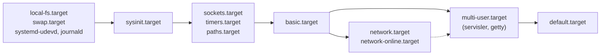

# 6 · init sistemleri ve systemd

<div class="kunye" markdown>
<span>Süre: ~60 dk + uygulama</span><span>Düzey: Orta</span><span>Ön koşul: Bölüm 1 ve 5</span>
</div>

!!! hedef "Öğrenme hedefleri"
    Bu bölümün sonunda:

    - PID 1'in görevlerini ve bir init sistemi seçerken dikkate alınacak ölçütleri açıklayabilirsiniz.
    - SysVinit ve BusyBox init'in `inittab` ve betik tabanlı çalışmasını açıklayabilirsiniz.
    - systemd birim türlerini, birim dosyası dizinlerini ve ek dosyaları (drop-in) kullanabilirsiniz.
    - `Requires`, `Wants`, `After`, `Before` ve `WantedBy` arasındaki farkı açıklayabilirsiniz.
    - Açılış hedeflerini (target) ve açılışın nasıl sıralandığını yorumlayabilirsiniz.
    - Bir servis birimi yazıp `systemd-analyze` ile doğrulayabilir ve güvenlik düzeyini değerlendirebilirsiniz.
    - journald günlük deposunu gömülü sistemin depolama koşullarına göre yapılandırabilirsiniz.
    - Yocto'da `INIT_MANAGER` ve `systemd` sınıfı ile servisleri imaja ekleyebilirsiniz.

## 6.1 PID 1'in görevleri

[Bölüm 1](01-onyukleme-zinciri.md)'de görüldüğü gibi çekirdek, kök dosya sistemi hazır olduğunda tek bir
kullanıcı alanı programını çalıştırır ve sistemin geri kalanını ona bırakır. Bu program, **init**, şu
görevleri üstlenir:

- **Erken sistem hazırlığı:** sanal dosya sistemlerini (`/proc`, `/sys`, `/dev`, `/run`, `/tmp`)
  bağlamak, kök dosya sistemini yazılabilir yapmak, `/etc/fstab` girdilerini bağlamak, saat ve ana
  bilgisayar adını ayarlamak, aygıt yöneticisini başlatmak.
- **Servislerin yönetimi:** servisleri doğru sırayla başlatmak, çöken servisleri yeniden başlatmak,
  servislerin günlüklerini toplamak.
- **Oturum açma:** seri konsolda ve diğer terminallerde oturum açma istemini (getty) sunmak ve sonlandığında
  yeniden başlatmak.
- **Süreç yönetimi:** öksüz süreçleri devralmak ve çıkış durumlarını toplamak.
- **Kapanış:** servisleri durdurmak, dosya sistemlerini ayırmak, sistemi kapatmak veya yeniden başlatmak.

Gömülü Linux'ta üç init sistemi yaygındır. Seçim; servis sayısına, bellek ve depolama sınırlarına,
açılış süresi hedefine ve servis denetimi gereksinimlerine (yeniden başlatma, bekçi köpeği, kaynak sınırları)
göre yapılır:

| | BusyBox init | SysVinit | systemd |
|---|---|---|---|
| Yapılandırma | `/etc/inittab` + `rcS` betiği | `/etc/inittab` + `/etc/init.d` betikleri, `rcN.d` bağlantıları | Birim dosyaları |
| Sıralama | Betikteki satır sırası | Bağlantı adlarındaki numara (`S10`, `S20`) | Bağımlılık grafiği; paralel başlatma |
| Servis denetimi | Yalnızca `respawn` | Yok (betiğe bağlı) | Yeniden başlatma, bekçi köpeği, cgroup, kaynak sınırları |
| Günlük | `syslogd` | `syslogd` | journald |
| Boyut | Birkaç KiB (BusyBox'ın parçası) | Küçük | Birkaç MiB |
| Yocto `INIT_MANAGER` | `mdev-busybox` | `sysvinit` | `systemd` |

## 6.2 SysVinit ve BusyBox init

**SysVinit**, Unix System V'den gelen geleneksel yöntemdir. `/sbin/init`, `/etc/inittab` dosyasını okur
ve sistemi bir **çalışma düzeyine** (*runlevel*, 0–6) getirir. Her çalışma düzeyi için `/etc/rcN.d/`
dizininde `/etc/init.d/` altındaki betiklere bağlantılar bulunur: `S` ile başlayanlar o düzeye
girerken `start`, `K` ile başlayanlar çıkarken `stop` argümanıyla, adlarındaki numara sırasıyla çalıştırılır.
Bağlantılar `update-rc.d` aracıyla oluşturulur. Yöntem basit ve şeffaftır; ancak bağımlılıklar yalnızca
numaralarla ifade edilir, servisler sırayla başlatılır ve çöken bir servis kendiliğinden yeniden başlatılmaz.

**BusyBox init**, aynı `inittab` adını kullanan, ancak çok daha basit bir biçimdir. Çalışma düzeyleri
yoktur; her satır `<tty>::<eylem>:<komut>` biçimindedir. Kitabın örnek sistemi bu yöntemi kullanır:

```text title="examples/initramfs/inittab"
::sysinit:/etc/init.d/rcS
ttyAMA0::respawn:/sbin/getty -L 115200 ttyAMA0 vt100
::ctrlaltdel:/sbin/reboot
::shutdown:/bin/umount -a -r
```

| Eylem | Anlamı |
|---|---|
| `sysinit` | Açılışta ilk çalıştırılır; bitmesi beklenir |
| `wait` | `sysinit` sonrasında çalıştırılır; bitmesi beklenir |
| `once` | Bir kez başlatılır; bitmesi beklenmez |
| `respawn` | Sonlandığında yeniden başlatılır (getty, sürekli çalışan servisler) |
| `askfirst` | `respawn` gibi, ancak önce konsolda "Enter" bekler |
| `ctrlaltdel`, `shutdown`, `restart` | İlgili olayda çalıştırılır |

`/etc/inittab` bulunmazsa BusyBox init varsayılan bir davranış uygular (`/etc/init.d/rcS` ve konsolda
`askfirst` ile kabuk). Örnek sistemin `rcS` betiği sanal dosya sistemlerini bağlar, mdev'i etkinleştirip
soğuk tarama yapar ([Bölüm 5](05-kullanici-alani-arayuzleri.md)), ana bilgisayar adını ayarlar ve ağ
arayüzünü DHCP ile yapılandırır. Aşağıdaki oturum, çalışan sistemde PID 1'in ve `respawn` davranışının
incelenmesini gösterir:

<div class="terminal" data-oturum="busybox-init"></div>

!!! sss "Betik tabanlı init gömülü üründe yeterli midir?"
    Tek bir uygulama ve birkaç yardımcı servisten oluşan, bellek ve depolaması çok kısıtlı ürünlerde
    BusyBox init yeterli ve uygundur. Ancak servis sayısı arttığında, servislerin birbirini beklemesi
    gerektiğinde, çöken servislerin denetimli yeniden başlatılması, kaynak sınırları veya donanım bekçi
    köpeği entegrasyonu istendiğinde bu özellikler betiklerle yeniden yazılmak zorunda kalınır. Bu
    noktada systemd'nin hazır mekanizmaları genellikle daha az hataya yol açar.

## 6.3 systemd: birimler

**systemd**, güncel Linux dağıtımlarının ve Yocto 6.0 nodistro yapılandırmasının varsayılan init
sistemidir. Yönetilen her nesne bir **birimdir** (*unit*) ve bir birim dosyasıyla tanımlanır:

| Birim türü | Uzantı | Tanımladığı nesne |
|---|---|---|
| Servis | `.service` | Bir süreç veya süreç grubu |
| Hedef | `.target` | Birimleri gruplayan eşitleme noktası (eski çalışma düzeylerinin karşılığı) |
| Soket | `.socket` | Dinleyen bir yuva; bağlantı geldiğinde servisi başlatır |
| Zamanlayıcı | `.timer` | Belirli zamanlarda veya aralıklarla bir servisi başlatır (cron'un karşılığı) |
| Bağlama | `.mount`, `.automount` | Dosya sistemi bağlama noktaları; `/etc/fstab` satırlarından da üretilir |
| Aygıt | `.device` | udev'in `TAG+="systemd"` ile işaretlediği aygıtlar |
| Yol | `.path` | Bir dosya veya dizindeki değişiklik |
| Dilim, kapsam | `.slice`, `.scope` | cgroup tabanlı kaynak gruplaması |

Birim dosyaları üç dizinde aranır; aynı adlı dosyalarda öncelik sırası şöyledir:

1. `/etc/systemd/system/`: yöneticinin (ve ürünün) yerel ayarları
2. `/run/systemd/system/`: çalışma anında oluşturulanlar
3. `/usr/lib/systemd/system/`: paketlerin kurduğu dosyalar

Bir paketin kurduğu birim dosyasını değiştirmek için dosya kopyalanmaz; **ek dosya** (*drop-in*) yazılır:
`/etc/systemd/system/sensor-toplayici.service.d/ornek.conf` içindeki satırlar asıl dosyanın üzerine
uygulanır. Bu yöntem, paket güncellendiğinde yerel değişikliklerin korunmasını ve yukarı akıştaki
değişikliklerin de alınmasını sağlar. Bir liste değerini (ör. `ExecStart=`) değiştirmek için önce boş
atama yapılarak önceki değer silinir.

## 6.4 Bağımlılık ve sıralama

systemd'de **gereksinim** ve **sıralama** iki ayrı kavramdır ve ayrı ayrı belirtilir:

| Yönerge | Anlamı |
|---|---|
| `Wants=B` | A başlatılırken B de başlatılır; B başarısız olursa A etkilenmez |
| `Requires=B` | A başlatılırken B de başlatılır; B başlatılamazsa A da başlatılmaz, B durdurulursa A da durdurulur |
| `Requisite=B` | B zaten çalışmıyorsa A başlatılmaz; B başlatılmaya çalışılmaz |
| `BindsTo=B` | `Requires` gibi, ayrıca B herhangi bir nedenle durursa A da durur (aygıtlara bağlı servisler) |
| `PartOf=B` | B durdurulduğunda veya yeniden başlatıldığında A da etkilenir |
| `Conflicts=B` | A ve B birlikte çalışamaz |
| `After=B` / `Before=B` | Yalnızca **sıra**: ikisi birlikte başlatılacaksa A, B'den sonra/önce başlatılır |

`Wants=B` tek başına sıra belirtmez: A ve B **paralel** başlatılır. "A, B hazır olduktan sonra başlasın"
denmek isteniyorsa `Wants=B` ile birlikte `After=B` yazılmalıdır. Tersine, `After=B` tek başına B'yi
başlatmaz; B başka bir nedenle başlatılıyorsa sıra uygulanır. Bu ayrım systemd ile ilgili hataların en
yaygın kaynağıdır.

**`[Install]`** bölümü birimin çalışma anındaki davranışını değil, `systemctl enable` komutunun ne
yapacağını tanımlar. `WantedBy=multi-user.target` satırı, etkinleştirmede
`/etc/systemd/system/multi-user.target.wants/` dizinine birime bir bağlantı oluşturur; bu bağlantı,
`multi-user.target` için bir `Wants=` bağımlılığının dosya sistemindeki karşılığıdır.

## 6.5 Açılış hedefleri

systemd açılışta `default.target` birimini (genellikle `multi-user.target`'a bir bağlantı) etkinleştirir
ve bağımlılık grafiğini geriye doğru izleyerek gereken tüm birimleri bulur. Belli başlı hedefler
`systemd.special(7)` belgesinde tanımlanmıştır:



- **`sysinit.target`**: erken açılış; dosya sistemleri, udev, journald, sysctl.
- **`basic.target`**: soketler, zamanlayıcılar ve temel sistem hazır. Çoğu servis varsayılan olarak bu
  hedefin sonrasına sıralanır (`DefaultDependencies=yes`).
- **`network-online.target`**: ağın yapılandırıldığı an. Kendisi bir şey yapmaz; anlamı ağ yöneticisinin
  "bekleme" servisinden gelir (`systemd-networkd-wait-online.service`).
- **`multi-user.target`**: ekransız bir ürünün tam çalışır durumu.
- **`rescue.target`**, **`emergency.target`**: kurtarma kipleri. Çekirdek komut satırına
  `systemd.unit=rescue.target` yazılarak seçilir.

Aşağıdaki animasyon, örnek ürünün servisinin hedefe bağlanmasını ve açılışta sıralanmasını gösterir:

<div class="akis" data-senaryo="systemd-hedef"></div>

## 6.6 Servis yazımı

Örnek ürünün sürekli çalışan toplama servisi, bu bölümde anlatılan öğeleri bir araya getirir:

```ini title="examples/systemd/sensor-toplayici.service (kısaltılmış)"
[Unit]
Description=Örnek ağ geçidi sensör toplayıcı
Wants=network-online.target          # (1)!
After=network-online.target
ConditionPathExists=/dev/sensor-uart # (2)!

[Service]
Type=simple                          # (3)!
ExecStart=/usr/bin/sensor-oku 100
Restart=on-failure                   # (4)!
RestartSec=5s
DynamicUser=yes                      # (5)!
SupplementaryGroups=dialout
CapabilityBoundingSet=
ProtectSystem=strict
DevicePolicy=closed
DeviceAllow=/dev/sensor-uart rw
SystemCallFilter=@system-service

[Install]
WantedBy=multi-user.target           # (6)!
```

1.  **İstek ve sıra birlikte.** Ağın yapılandırılması hem istenir hem beklenir.
2.  **Koşul.** Sensör aygıtı yoksa servis başarısız sayılmaz, yalnızca atlanır. Aygıt sonradan takılırsa
    [Bölüm 5](05-kullanici-alani-arayuzleri.md)'teki udev kuralı (`ENV{SYSTEMD_WANTS}`) servisi başlatır.
3.  **Servis türü.** `simple`: `ExecStart` süreci servisin kendisidir ve başlatıldığı an hazır sayılır.
    `exec`: süreç başarıyla `exec` edildiğinde hazır sayılır. `forking`: geleneksel arka plan süreçleri.
    `oneshot`: biten işler. `notify`: süreç hazır olduğunu `sd_notify("READY=1")` ile bildirir.
4.  **Yeniden başlatma.** Süreç sıfır olmayan bir kodla çıkarsa veya bir sinyalle sonlanırsa 5 saniye sonra
    yeniden başlatılır. `StartLimitBurst` ve `StartLimitIntervalSec` sürekli çöken bir servisin sonsuz
    döngüye girmesini engeller.
5.  **Ayrıcalıkların azaltılması.** Servis, çalışma anında oluşturulan ayrıcalıksız bir kullanıcıyla
    çalışır; yalnızca sensör aygıtına erişebilir, dosya sisteminin büyük bölümü salt okunurdur ve
    sistem çağrıları bir izin listesiyle sınırlanmıştır.
6.  **Etkinleştirme.** `systemctl enable` ile `multi-user.target.wants/` altına bağlantı oluşturulur.

Birim dosyası ve zamanlayıcı ile çalışan tek seferlik okuma servisi derleme makinesinde, hedef kök
dosya sistemini temsil eden bir dizin üzerinde (`--root`) denetlenmiştir:

<div class="terminal" data-oturum="systemd-analyze"></div>

`systemd-analyze security` her korumayı ağırlıklandırarak 0 (en iyi) ile 10 arasında bir "maruz kalma"
puanı hesaplar. Puan bir hedef değil, bir kontrol listesidir: her satır, servisin neye erişebileceğini
açıkça gösterir. Çıktıda kalan satırlar bilinçli kararlardır; örneğin servisin ağa veri göndermesi
gerektiği için `PrivateNetwork=` kullanılmamıştır.

!!! dikkat "Bekçi köpeği: servis düzeyi ve sistem düzeyi"
    `WatchdogSec=30s` yazılan bir `Type=notify` servisi her 30 saniyede bir `sd_notify("WATCHDOG=1")`
    göndermezse systemd onu sonlandırır ve `Restart=` politikası uygulanır. Bu, takılan bir uygulamayı
    yakalar. systemd'nin kendisinin takılmasına karşı ise `/etc/systemd/system.conf` içindeki
    `RuntimeWatchdogSec=` ile donanım bekçi köpeği (`/dev/watchdog`) kullanılır. İkisi birbirinin
    yerine geçmez; ürünlerde genellikle ikisi birlikte kullanılır.

## 6.7 journald ve günlük yönetimi

systemd-journald, servislerin standart çıktısını, `syslog` iletilerini ve çekirdek iletilerini yapısal
bir günlükte toplar. Her kayıt servis adı, PID, öncelik ve zaman damgası gibi alanlarla saklanır;
`journalctl` bu alanlara göre süzer:

```bash
journalctl -b                         # bu açılışın tüm kayıtları
journalctl -b -1 -p err               # bir önceki açılışın hata ve üstü kayıtları
journalctl -u sensor-toplayici -f     # bir servisi canlı izle
journalctl -k                         # yalnızca çekirdek iletileri (dmesg karşılığı)
journalctl --disk-usage
```

Günlüğün nerede saklanacağı `/etc/systemd/journald.conf` içindeki `Storage=` ile belirlenir: `volatile`
(yalnızca `/run/log/journal`, RAM'de), `persistent` (`/var/log/journal`), `auto` (dizin varsa kalıcı).
Flaş bellekli gömülü cihazlarda sürekli günlük yazımı aşınmaya yol açar; yaygın uygulama, günlüğü RAM'de
tutmak (`Storage=volatile`, `RuntimeMaxUse=8M`) ve yalnızca gerekli kayıtları ağ üzerinden bir merkeze
göndermektir. Kalıcı günlük gerekiyorsa `SystemMaxUse=` ile üst sınır konulmalı ve günlük ayrı bir
bölümde tutulmalıdır.

## 6.8 `systemd-analyze` ile açılış çözümlemesi

`systemd-analyze` çalışan bir sistemde açılış süresini ve sırasını çözümler. Bu komutlar hedef cihazda
çalıştırılır; aşağıdaki çıktı biçimi **temsilidir** ve bu kitabın QEMU sistemi BusyBox init kullandığı
için orada alınmamıştır:

```text
root@agecidi:~# systemd-analyze time
Startup finished in 1.204s (kernel) + 3.512s (userspace) = 4.716s
multi-user.target reached after 3.498s in userspace.
root@agecidi:~# systemd-analyze critical-chain sensor-toplayici.service
sensor-toplayici.service @3.401s
└─network-online.target @3.398s
  └─systemd-networkd-wait-online.service @1.702s +1.694s
    └─systemd-networkd.service @1.511s +187ms
      └─systemd-udevd.service @0.902s +241ms
```

| Komut | İşlev |
|---|---|
| `systemd-analyze time` | Çekirdek, initrd ve kullanıcı alanında geçen süre |
| `systemd-analyze blame` | Birimlerin başlatılma sürelerine göre sıralı listesi |
| `systemd-analyze critical-chain [birim]` | Bir birime giden en uzun bekleme zinciri |
| `systemd-analyze plot > acilis.svg` | Açılışın zaman çizelgesi (SVG) |
| `systemd-analyze verify <birim>` | Birim dosyasını denetler (derleme makinesinde de çalışır) |
| `systemd-analyze security <birim>` | Güvenlik ayarlarını değerlendirir (`--offline=yes` ile derleme makinesinde) |
| `systemd-analyze calendar <ifade>` | Zamanlayıcı ifadesinin bir sonraki çalışma zamanlarını gösterir |

`blame` çıktısı yanıltıcı olabilir: uzun süren bir birim, başka birimleri beklemediği sürece açılışı
geciktirmez. Açılışı gerçekten geciktiren birimler `critical-chain` ile bulunur. Gömülü üründe en sık
rastlanan gecikme, ağ hiç bağlanmadığında `systemd-networkd-wait-online.service` biriminin zaman aşımına
kadar beklemesidir; `network-online.target` yalnızca gerçekten ağa ihtiyaç duyan servislerde
kullanılmalıdır.

## 6.9 Yocto'da init sistemi ve servisler

Init sistemi dağıtım düzeyinde `INIT_MANAGER` ile seçilir (`systemd`, `sysvinit`, `mdev-busybox`); değer
`conf/distro/include/init-manager-${INIT_MANAGER}.inc` dosyasını içerir ve `VIRTUAL-RUNTIME_init_manager`,
`VIRTUAL-RUNTIME_dev_manager` gibi değişkenleri ayarlar. ÖrnekOS `INIT_MANAGER = "systemd"` kullanır
(<a href="../../yocto-gomulu-linux/bolumler/11-distro.html">Yocto kitabı, Bölüm 11</a>).

Bir tarifin systemd servisi kurması için **`systemd` sınıfı** devralınır:

```bitbake title="sensor-toplayici_1.0.bb (kısaltılmış)"
SRC_URI = "file://sensor-toplayici.service"
S = "${UNPACKDIR}"

inherit systemd

SYSTEMD_SERVICE:${PN} = "sensor-toplayici.service"
SYSTEMD_AUTO_ENABLE = "enable"            # varsayılan; "disable" ile kurulur ama etkinleştirilmez

do_install() {
    install -d ${D}${systemd_system_unitdir}
    install -m 0644 ${UNPACKDIR}/sensor-toplayici.service ${D}${systemd_system_unitdir}/
}

RDEPENDS:${PN} = "sensor-oku"
```

Sınıf, imaj oluşturulurken `systemctl preset` (veya `enable`) çalıştırarak `[Install]` bölümündeki
bağlantıları kök dosya sisteminde oluşturur; yani yukarıdaki `systemctl --root` oturumunun yaptığını
derleme sırasında yapar. `${systemd_system_unitdir}` genellikle `/usr/lib/systemd/system`'dir.
Dağıtımda `systemd` özelliği yoksa sınıf servisleri kurmaz. Seri konsollarda oturum açma istemi, makine
dosyasındaki `SERIAL_CONSOLES` değerinden `serial-getty@<tty>.service` örnekleri olarak üretilir
([Bölüm 7](07-sistem-yonetimi.md)). Örnek katmandaki `ornek-servis` sınıfı, bu kalıbı sınıf olarak
paketleyen bir örnektir (<a href="../../yocto-gomulu-linux/bolumler/08-siniflar.html">Yocto kitabı, Bölüm 8</a>).

!!! lab "Uygulama 6.1 · Servis biriminin derleme makinesinde doğrulanması"
    Hedef kök dosya sistemi bir dizinle temsil edilir; birimler ve ikili dosya bu dizine kurulur:

    ```bash
    mkdir -p kok/usr/bin kok/usr/lib/systemd/system
    gcc -O2 -o kok/usr/bin/sensor-oku ~/cekirdek-onyukleme/examples/initramfs/sensor-oku.c
    cp /usr/lib/systemd/system/*.target kok/usr/lib/systemd/system/
    cp ~/cekirdek-onyukleme/examples/systemd/sensor-* kok/usr/lib/systemd/system/
    systemd-analyze verify --root=kok sensor-toplayici.service sensor-oku.timer
    systemctl --root=kok enable sensor-toplayici.service sensor-oku.timer
    systemd-analyze security --offline=yes --root=kok sensor-toplayici.service | tail -3
    ```

    1. `verify` komutunun çıktı vermemesi birimlerin geçerli olduğunu gösterir. `ExecStart=` satırındaki
       yolu `/usr/bin/yok` olarak değiştirip komutu yeniden çalıştırın ve hatayı inceleyin.
    2. `enable` komutunun oluşturduğu bağlantıları `find kok/etc -type l -ls` ile listeleyin.
    3. `sensor-toplayici.service` dosyasından `DynamicUser=yes` ve `CapabilityBoundingSet=` satırlarını
       kaldırıp güvenlik puanının nasıl değiştiğini gözleyin.
    4. Zamanlayıcının ifadesini `systemd-analyze calendar '*:0/15'` ile ve `OnUnitActiveSec=15min`
       değerini `systemd-analyze timespan 15min` ile yorumlayın.

## Özet

- PID 1; erken hazırlık, servis yönetimi, oturum açma, öksüz süreçlerin toplanması ve kapanıştan sorumludur.
- BusyBox init `<tty>::<eylem>:<komut>` biçimli `inittab` ve `rcS` betiğiyle çalışır; `respawn` sürekli çalışan süreçler içindir. SysVinit çalışma düzeyleri ve numaralı bağlantılar kullanır.
- systemd'de her nesne bir birimdir; `/etc` > `/run` > `/usr/lib` önceliği geçerlidir ve değişiklikler ek dosyalarla yapılır.
- Gereksinim (`Wants`, `Requires`, `BindsTo`) ile sıra (`After`, `Before`) ayrıdır; `[Install]` yalnızca `enable` davranışını tanımlar.
- Açılış `default.target` → `multi-user.target` → `basic.target` → `sysinit.target` zinciriyle çözülür; `network-online.target` yalnızca gerekli servislerde kullanılmalıdır.
- `systemd-analyze` birimleri doğrular, güvenlik düzeyini değerlendirir ve açılışı çözümler; `critical-chain` gerçek gecikmeyi gösterir.
- journald depolama türü flaş ömrü göz önüne alınarak seçilmelidir.
- Yocto'da `INIT_MANAGER` init sistemini, `systemd` sınıfı ve `SYSTEMD_SERVICE` servisleri belirler.

## Değerlendirme soruları

<div class="quiz" data-id="b06-1">
<p class="quiz-soru">Bir servis biriminde <code>Wants=network-online.target</code> yazılıdır, ancak <code>After=</code> satırı yoktur. Servis açılışta ne zaman başlatılır?</p>
<ul>
<li>Ağ yapılandırıldıktan sonra</li>
<li data-dogru><code>network-online.target</code> ile paralel olarak; ağın hazır olması beklenmez</li>
<li>Hiç başlatılmaz</li>
<li>Ağ yapılandırılamazsa başlatılmaz</li>
</ul>
<p class="quiz-aciklama"><code>Wants=</code> yalnızca gereksinimdir. Sıra için <code>After=network-online.target</code> ayrıca yazılmalıdır.</p>
</div>

<div class="quiz" data-id="b06-2">
<p class="quiz-soru"><code>/usr/lib/systemd/system/sensor-toplayici.service</code> dosyasındaki <code>RestartSec=5s</code> değeri ürüne özgü olarak 30 saniye yapılmak istenmektedir. Önerilen yöntem hangisidir?</p>
<ul>
<li>Paketin kurduğu dosyayı doğrudan düzenlemek</li>
<li data-dogru><code>/etc/systemd/system/sensor-toplayici.service.d/</code> altına <code>[Service]</code> ve <code>RestartSec=30s</code> içeren bir ek dosya yazmak</li>
<li>Dosyayı <code>/run/systemd/system/</code> altına kopyalamak</li>
<li>Çekirdek komut satırına parametre eklemek</li>
</ul>
<p class="quiz-aciklama">Ek dosyalar (drop-in) asıl birimin üzerine uygulanır; paket güncellendiğinde yerel değişiklik korunur, yukarı akış değişiklikleri de alınır.</p>
</div>

<div class="quiz" data-id="b06-3">
<p class="quiz-soru">BusyBox init kullanan bir sistemde <code>inittab</code> satırı <code>ttyAMA0::respawn:/sbin/getty -L 115200 ttyAMA0 vt100</code> biçimindedir. Konsolda oturum kapatıldığında ne olur?</p>
<ul>
<li>Konsol kapanır ve yeniden açılmaz</li>
<li data-dogru>Kabuk sonlanır; init getty'yi yeniden başlatır ve yeni bir oturum açma istemi görülür</li>
<li>Sistem yeniden başlatılır</li>
<li>init sonlanır ve çekirdek panik durumuna geçer</li>
</ul>
<p class="quiz-aciklama"><code>respawn</code> eylemi, süreç sonlandığında onu yeniden başlatır. getty oturum açılınca yerini <code>login</code> ve kabuğa bırakır; kabuk sonlandığında süreç biter ve init yeniden başlatır.</p>
</div>

<div class="quiz" data-id="b06-4">
<p class="quiz-soru"><code>systemd-analyze blame</code> çıktısında en üstte 8 saniye ile bir veritabanı servisi görünmektedir, ancak <code>systemd-analyze time</code> toplam kullanıcı alanı süresini 3 saniye göstermektedir. Bu nasıl mümkündür?</p>
<ul>
<li><code>blame</code> çıktısı her zaman hatalıdır</li>
<li data-dogru>Servis, açılış hedefine ulaşılmasını beklemeyen bir birimdir; arka planda uzun sürmesi açılışı geciktirmemiştir</li>
<li>Servis iki kez başlatılmıştır</li>
<li><code>time</code> komutu servisleri saymaz</li>
</ul>
<p class="quiz-aciklama"><code>blame</code> başlatma sürelerini listeler, ancak bekleme ilişkilerini göstermez. Açılışı geciktiren zincir <code>critical-chain</code> ile bulunur.</p>
</div>

<div class="quiz" data-id="b06-5">
<p class="quiz-soru">Yocto'da <code>inherit systemd</code> ve <code>SYSTEMD_SERVICE:${PN} = "sensor-toplayici.service"</code> kullanan bir tarifin servisi, imajda açılışta neden kendiliğinden başlar?</p>
<ul>
<li>systemd <code>/usr/lib/systemd/system</code> altındaki her servisi başlatır</li>
<li data-dogru>Sınıf, imaj oluşturulurken birimi <code>[Install]</code> bölümüne göre etkinleştirir (varsayılan <code>SYSTEMD_AUTO_ENABLE = "enable"</code>) ve <code>.wants</code> bağlantısı oluşturulur</li>
<li>Tarif <code>/etc/rc.local</code> dosyasına satır ekler</li>
<li><code>IMAGE_INSTALL</code> değişkeni servisleri başlatır</li>
</ul>
<p class="quiz-aciklama">Etkinleştirme, <code>WantedBy=</code> hedefinin <code>.wants</code> dizininde bir bağlantıdır. Sınıf bunu derleme sırasında <code>systemctl preset</code>/<code>enable</code> ile yapar.</p>
</div>

!!! alistirma "Alıştırma: Zamanlayıcıyla çalışan okuma ve günlük sınırı"
    Ağ geçidinin her 15 dakikada bir tek seferlik sensör okuması yapması, okumaların journald'de
    tutulması ve günlüğün flaşa hiç yazılmaması istenmektedir.

    1. `sensor-oku.service` ve `sensor-oku.timer` birimlerini inceleyin; zamanlayıcının ilk çalışmasının
       açılıştan ne kadar sonra olacağını belirleyin.
    2. journald için RAM'de en fazla 8 MiB kullanan bir yapılandırma ek dosyası yazın.
    3. Okuma servisinin çıktısının günlükte hangi komutla görüleceğini yazın.
    4. Bu üç dosyanın Yocto'da hangi tariflerle imaja ekleneceğini açıklayın.

    ??? success "Örnek çözüm"
        1. `OnBootSec=1min` ilk çalışmayı açılıştan bir dakika sonraya, `OnUnitActiveSec=15min` sonraki
           çalışmaları servisin her etkinleşmesinden 15 dakika sonraya ayarlar. Zamanlayıcı
           `timers.target` tarafından istenir (`WantedBy=timers.target`). Zamanlayıcıyla çalışan servisin
           `[Install]` bölümü olmasına gerek yoktur; servisi zamanlayıcı etkinleştirir.
        2. `/etc/systemd/journald.conf.d/10-agecidi.conf`:

            ```ini
            [Journal]
            Storage=volatile
            RuntimeMaxUse=8M
            ```

        3. `journalctl -u sensor-oku.service -b` (canlı izlemek için `-f`); zamanlayıcının durumu için
           `systemctl list-timers sensor-oku.timer`.
        4. Servis ve zamanlayıcı, `inherit systemd` kullanan bir tarifle kurulur ve
           `SYSTEMD_SERVICE:${PN} = "sensor-oku.timer"` yazılır; böylece imajda yalnızca zamanlayıcı
           etkinleştirilir. `systemd` sınıfı, listelenen birimlerin dosyalarını pakete ekler, ancak bir
           `.timer` için eşleşen `.service` dosyasını kendiliğinden eklemez (bunu yalnızca `.socket`
           birimleri için yapar). Varsayılan `FILES:${PN}` de birim dizinini içermediğinden servis dosyası
           için `FILES:${PN} += "${systemd_system_unitdir}/sensor-oku.service"` satırı gerekir; aksi halde
           paketleme `installed-vs-shipped` denetimiyle durur. journald ek dosyası
           `${sysconfdir}/systemd/journald.conf.d/` altına kurulur; `${sysconfdir}` varsayılan
           `FILES:${PN}` kapsamındadır.

**Sonraki bölüm:** [7 · Seri konsol, ağ ve uzaktan erişim →](07-sistem-yonetimi.md)
