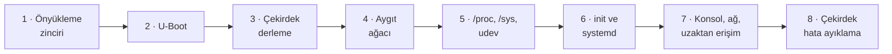

# Linux Çekirdeği ve Önyükleme

**Gömülü Linux sistemlerinde önyükleme zinciri, U-Boot, çekirdek, aygıt ağacı ve init sistemleri
üzerine açık kaynak, Türkçe başvuru ve öğretim kitabı.**

Bu kitap, bir gömülü Linux cihazına güç verildiği andan servislerin çalışır duruma geldiği ana kadar
geçen süreci uçtan uca ele alır: Boot ROM ve SPL'den U-Boot'a, çekirdeğin derlenmesinden aygıt ağacına,
`/sys` ve udev'den systemd'ye, seri konsoldan çekirdek hata ayıklamaya kadar. Her konu önce kavram ve
gerekçesiyle, ardından gerçek komutlar, çıktılar ve uygulama çalışmalarıyla anlatılır.

Kitap, **Gömülü Linux Kitaplığı**'nın bir parçasıdır ve
<a href="../yocto-gomulu-linux/index.html">Yocto Project ile Gömülü Linux</a> kitabının makine (BSP),
çekirdek ve init sistemi bölümlerinin dayandığı temel bilgiyi derinlemesine verir.

## Hedef kitle

- Yocto veya Buildroot ile ürün geliştiren ve önyükleme sorunlarını çözmek zorunda kalan mühendisler
- Yeni bir kart için BSP hazırlayan veya bir BSP'yi uyarlayan donanım ve yazılım ekipleri
- Çekirdek yapılandırması, aygıt ağacı ve sürücü yükleme süreçlerini anlamak isteyen geliştiriciler
- Gömülü sistemler, işletim sistemleri ve bilgisayar mimarisi derslerinin öğretim üyeleri ve öğrencileri

## Ön koşullar

- Linux komut satırını rahatça kullanabilmek
  (<a href="../bash-komut-satiri/index.html">Linux Komut Satırı ve Bash</a>)
- C derleme süreci ve Make hakkında temel bilgi
  (<a href="../c-derleme/index.html">C, Make ve CMake ile Derleme</a>)
- Uygulamalar için: Ubuntu 24.04 veya benzeri bir Linux geliştirme makinesi, yaklaşık 10 GB boş disk.
  Donanım gerekmez; tüm uygulamalar QEMU'nun ARM64 `virt` makinesinde yapılır.

## Kitabın yapısı

| Bölüm | Kapsam |
|---|---|
| [1 · Önyükleme zinciri](bolumler/01-onyukleme-zinciri.md) | Boot ROM, SPL/TPL, TF-A ve OP-TEE, yükleme adresleri, çekirdeğin açılışı, initramfs, kök dosya sistemi, PID 1; x86 UEFI/GRUB ile farklar |
| [2 · U-Boot](bolumler/02-u-boot.md) | Yapılandırma ve derleme, konsol komutları, ortam değişkenleri, `bootcmd`/`bootargs`, standart önyükleme ve `extlinux.conf`, `boot.scr`, FIT ve imzalı önyükleme, Yocto'da `u-boot` |
| [3 · Çekirdek kaynak ağacı, Kconfig ve Kbuild](bolumler/03-cekirdek-derleme.md) | Ağaç yapısı, `defconfig` ve parçalar, Kconfig dili, `autoconf.h`, `obj-y`/`obj-m`, derleme çıktıları, modül kurulumu, komut satırı, `linux-yocto` |
| [4 · Aygıt ağacı](bolumler/04-aygit-agaci.md) | `.dts`/`.dtsi`/`.dtb`, sözdizimi, `compatible`, `reg`, kesmeler, bağlamalar ve dt-schema, `dtc`, çekirdeğin ağacı kullanması, bindirmeler |
| [5 · Çekirdek ile kullanıcı alanı arayüzleri](bolumler/05-kullanici-alani-arayuzleri.md) | Sistem çağrıları, `/proc`, `/sys`, uevent, udev ve mdev, `/dev`, `modprobe` ve `modules.dep`, ürün yazılımı yükleme |
| [6 · init sistemleri ve systemd](bolumler/06-init-systemd.md) | PID 1, SysVinit, BusyBox init, birimler, bağımlılık ve sıralama, hedefler, servis yazımı, journald, `systemd-analyze`, `INIT_MANAGER` |
| [7 · Seri konsol, ağ ve uzaktan erişim](bolumler/07-sistem-yonetimi.md) | UART, `console=`, getty, iproute2 ve systemd-networkd, SSH, TFTP ve NFS ile ağdan önyükleme, RTC ve NTP |
| [8 · Çekirdek hata ayıklama](bolumler/08-cekirdek-hata-ayiklama.md) | `printk` düzeyleri, `dmesg`, dynamic debug, ftrace, oops okuma, panik, kdump, kgdb, QEMU ile hata ayıklama |

## Örnek proje

Kitaplığın tüm kitaplarında olduğu gibi, örnekler ekransız bir **endüstriyel sensör ağ geçidi**
(`agecidi`) üzerinden ilerler. Bu kitapta ağ geçidinin önyükleme ve çekirdek katmanları gerçek
araçlarla kurulur:

- **Linux 6.18** çekirdeği, kitabın `agecidi.config` yapılandırma parçasıyla ARM64 için derlenir.
- BusyBox tabanlı küçük bir kök dosya sistemi, bir **initramfs** ve iki bölümlü bir disk imajı hazırlanır.
- Sistem QEMU'da **U-Boot** üzerinden `extlinux.conf`, `boot.scr`, FIT imajı veya TFTP ile açılır.
- Hayalî "Örnek SoC 1" yongası ve ağ geçidi kartı için bir **aygıt ağacı** ve bir bindirme yazılır,
  dt-schema ile doğrulanır.
- `ornek_bilgi` adlı küçük bir çekirdek modülü; sysfs parametreleri, ürün yazılımı yükleme, dynamic debug,
  ftrace ve oops çözümlemesi için kullanılır.
- systemd birimleri, udev kuralları ve ağ yapılandırması derleme makinesinde doğrulanır.

Tüm dosyalar deponun `examples/` dizinindedir; hangi dosyanın hangi bölümde kullanıldığı
`examples/README.md` dosyasında listelenir. Kitaptaki terminal çıktıları bu dosyalarla gerçekten
çalıştırılarak alınmıştır; gerçek donanım gerektiren ve bu ortamda alınamayan çıktılar metinde
**temsilî** olarak belirtilmiştir.

## Sürüm kapsamı

!!! info "Bu kitap aşağıdaki sürümler esas alınarak yazılmıştır"
    - **Linux 6.18** (Yocto Project 6.0 *Wrynose* `linux-yocto` sürümü)
    - **U-Boot 2026.01** (Yocto 6.0 `u-boot` tarifi); QEMU çıktıları Ubuntu 24.04'ün U-Boot 2025.10 paketiyle alınmıştır
    - **QEMU 8.2**, **BusyBox 1.36.1**, **systemd 255** (derleme makinesindeki doğrulamalar)
    - **dtc 1.7.0**, **dtschema 2026.9**

    Sürüme bağlı ayrıntılar metinde belirtilmiştir.

## Kitaplıktaki diğer kitaplarla ilişkisi

| Kitap | İlişki |
|---|---|
| <a href="../yocto-gomulu-linux/index.html">Yocto Project ile Gömülü Linux</a> | Bu kitaptaki kavramların Yocto karşılıkları (makine dosyası, `linux-yocto`, `u-boot`, `INIT_MANAGER`); her bölümde ilgili Yocto bölümüne bağlantı verilir |
| <a href="../aygit-surucusu/index.html">Linux Aygıt Sürücüsü Geliştirme</a> | Bu kitabın aygıt ağacı ve sysfs anlatımının sürücü tarafı; modül yazımı ve platform sürücüleri |
| <a href="../c-derleme/index.html">C, Make ve CMake ile Derleme</a> | Çapraz derleme, ELF ve Make temelleri |
| <a href="../bash-komut-satiri/index.html">Linux Komut Satırı ve Bash</a> | initramfs ve init betiklerinde kullanılan kabuk programlama |
| <a href="../git-surum-kontrolu/index.html">Git ile Sürüm Kontrolü</a> | Çekirdek ve U-Boot yamalarının hazırlanması |
| <a href="../python-gomulu/index.html">Gömülü Geliştirici için Python</a> | Derleme makinesi araçları ve otomasyon |

## Okuma önerileri

- **Baştan sona:** [Kitabın kullanımı](nasil-okunur.md) → [Bölüm 1](bolumler/01-onyukleme-zinciri.md). Uygulama 1.1 sonraki bölümlerin ortamını hazırlar.
- **"Kartım açılmıyor":** [Bölüm 1](bolumler/01-onyukleme-zinciri.md), [Bölüm 2](bolumler/02-u-boot.md) ve [Bölüm 7](bolumler/07-sistem-yonetimi.md)'deki seri konsol bölümü
- **BSP uyarlayanlar:** [Bölüm 3](bolumler/03-cekirdek-derleme.md) ve [Bölüm 4](bolumler/04-aygit-agaci.md)
- **Hızlı başvuru:** [Komut özeti](ekler/komut-ozeti.md), [Terimler sözlüğü](ekler/sozluk.md), [Animasyonlu şemalar](araclar/animasyonlar.md)

## Lisans ve katkı

Bu kitap açık kaynaklı bir topluluk çalışmasıdır. Metin
[CC BY-SA 4.0](https://creativecommons.org/licenses/by-sa/4.0/deed.tr), örnek kodlar MIT lisansıyla
yayımlanır; çekirdek modülü ve çekirdek ağacına eklenen Kconfig/Makefile örnekleri çekirdekle uyumlu
olması için GPL-2.0-only lisanslıdır. Düzeltme ve katkı önerileri her sayfanın üstündeki
:material-file-edit-outline: düğmesiyle iletilebilir.

<small>Linux, Linus Torvalds'ın tescilli markasıdır. U-Boot, QEMU, systemd ve diğer adlar ilgili
projelerin markalarıdır. Bu kitap bağımsız bir topluluk çalışmasıdır.</small>
